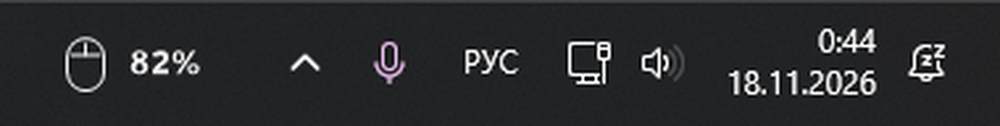
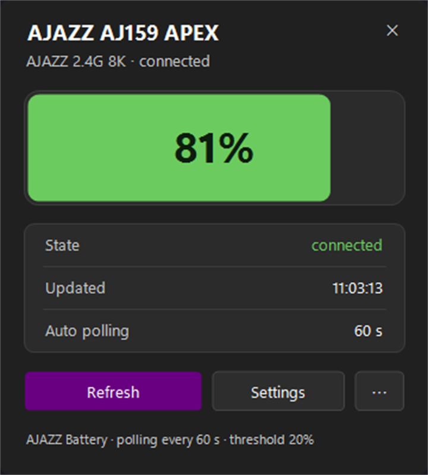
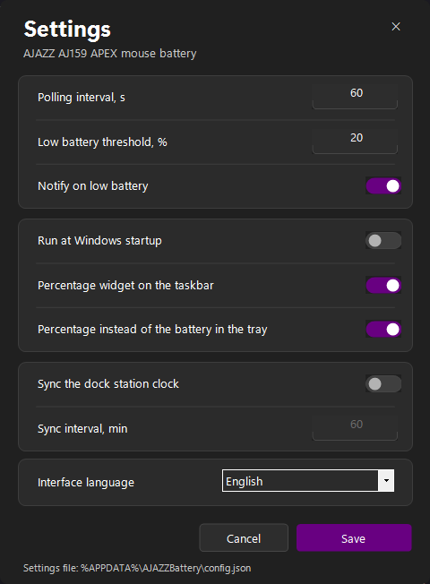
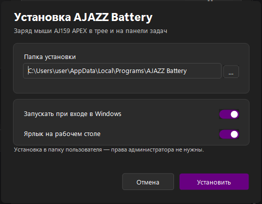

# AJAZZ Battery — battery level of the AJ159 APEX mouse in the Windows tray and taskbar

[](LICENSE)
[](#requirements)
[](https://github.com/kragel004-lab/ajazz-battery/releases/latest)
[](https://github.com/kragel004-lab/ajazz-battery/releases)
[](https://github.com/kragel004-lab/ajazz-battery/actions/workflows/build.yml)

[Русский](README.md) · **English**

Shows the battery level of the wireless **AJAZZ AJ159 APEX** mouse right in Windows: a neat
"mouse + 82 %" widget on the taskbar, a percentage in the tray and a Windows 11 style flyout.
No official AJAZZ driver is required — the app talks to the receiver/dock directly over HID.



## Download

| Edition | File | Size |
|---|---|---|
| **Installer** (recommended) | [`AJAZZ-Battery-Setup.exe`](https://github.com/kragel004-lab/ajazz-battery/releases/latest/download/AJAZZ-Battery-Setup.exe) | ~92 MB |
| **Portable** | [`AJAZZ-Battery-Portable.zip`](https://github.com/kragel004-lab/ajazz-battery/releases/latest/download/AJAZZ-Battery-Portable.zip) | ~40 MB |

All versions are on the [releases page](https://github.com/kragel004-lab/ajazz-battery/releases).
No .NET installation needed — the runtime is packed inside the exe. The files are not code-signed,
so SmartScreen may ask for confirmation on the first launch.



## Features

- **Taskbar widget** "mouse + percentage" — always visible, does not take a notification-area slot
  and does not create an app button. Click it to open the flyout. The widget hides itself in
  fullscreen apps and when the taskbar is hidden.
- **Tray percentage** — large digits or a battery icon (switchable), colour-coded: green ≥ 50 %,
  amber 20–49 %, red < 20 %.
- **Flyout** with a big charge indicator, connection state and the time of the last poll; closes on
  click outside and can be dragged by its header.
- **Charging indicator**: when the level grows, a bolt and "charging" appear in the flyout (see
  [limitations](#limitations) — the dongle has no explicit charging flag).
- **Low battery notification** with a configurable threshold.
- **Polling** every 60 s (configurable) and automatic reconnection when the dongle is re-plugged.
- **Run at Windows startup**.
- **Clock sync** for the dock screen (the famous "00:00" after a power loss) and **screen clear**
  for the dock.
- Light and dark themes that follow the system, with the system accent colour and Segoe UI Variable,
  just like Windows 11.
- Single instance: launching it again simply opens the flyout.



## Requirements

- Windows 10 or Windows 11, x64;
- AJAZZ AJ159 APEX mouse with the `2.4G 8K` receiver/dock (VID `0x3151`, PID `0x5007`);
- no .NET install needed — everything is inside the exe.

## Installation

### Option 1. Installer (usual way)

Run **`AJAZZ-Battery-Setup.exe`**:



- installs into the user profile `%LOCALAPPDATA%\Programs\AJAZZ Battery` — **no administrator rights
  required**;
- creates a Start menu shortcut (and a desktop one if the checkbox is on);
- registers "AJAZZ Battery" in **Settings → Apps**, uninstall from there;
- optionally enables autostart.

Silent install:

```powershell
AJAZZ-Battery-Setup.exe /S --dir "D:\Apps\AJAZZ Battery" --no-autostart --no-desktop --no-run
```

### Option 2. Portable

`AJAZZ-Battery-Portable.zip` — unpack anywhere and run `AjazzBattery.exe`. Nothing is installed,
shortcuts and registry are untouched. Settings live in `%APPDATA%\AJAZZBattery`.

To remove the portable edition just delete the folder.

## Usage

- **Left click the taskbar widget** or the tray icon — open/close the flyout.
- **Right click the tray icon** — menu: refresh, settings, dock clock sync, dock screen clear,
  autostart, log, exit.
- The tray icon may land in the overflow area (`^`) — drag it out if you want it visible.

The user interface is currently in Russian; English translation of the app itself is on the roadmap.

## Settings

| Option | Default | What it does |
|---|---|---|
| Poll interval, s | 60 | how often to query the battery |
| Low battery threshold, % | 20 | when to show the notification |
| Low battery notification | on | toast notification |
| Run at Windows startup | off | autostart (`HKCU\...\Run`) |
| Taskbar widget with percentage | on | "mouse + percentage" widget on the taskbar |
| Percentage instead of battery icon in tray | on | digits `81` instead of a battery glyph |
| Sync dock clock | off | push time to the dock screen |
| Clock sync interval, min | 60 | how often to repeat |

Settings file: `%APPDATA%\AJAZZBattery\config.json`, log: `app.log` next to it.

## Command line

```
AjazzBattery.exe               start the tray app
AjazzBattery.exe --check       print battery level and raw device response
AjazzBattery.exe --diag        diagnostics: found HID interfaces and their replies
AjazzBattery.exe --set-time    sync the dock clock
AjazzBattery.exe --clear-screen clear the dock screen
AjazzBattery.exe --uninstall   remove the app (for an installed copy)
```

`--check` is handy for testing on another PC:

```
Device     : AJAZZ 2.4G 8K
Battery    : 81%
Raw reply  : 00 00 00 51 01 00 01 02 ...
```

## How it works

AJAZZ has no official SDK; the protocol was reverse-engineered (from open projects for
AJ159/AJ179 and from the traffic of the qmk.top web configurator).

The receiver exposes a vendor HID interface (`usage page 0xFFFF`, 64-byte Feature Report,
report id 0):

```
SetFeature: 00 F7 00 00 ... 00        (status request)
GetFeature: 00 00 00 51 01 00 01 02 ...
                   ^^ byte 3 — battery percentage
```

Dock screen commands:

```
SetFeature: 00 28 00 00 00 00 00 00 D7 <year hi> <year lo> <month> <day> <hour> <min> <sec> ...
SetFeature: 00 AC 00 00 00 00 00 00 53 ...
```

A reply arrives in ~2–10 ms, so polling once a minute does not disturb the mouse.

## Resources

- Idle cost is almost nothing: one poll per minute (configurable), one HID request takes ~5 ms.
- The taskbar widget repaints only when the percentage, theme or taskbar geometry changes.
- CPU at idle ~0 %, memory 60–120 MB (the .NET runtime is packed into the exe).
- All traffic goes to the **receiver**, not to the mouse sensor, so cursor, 8 kHz polling and
  latency are unaffected.

## Limitations

- Only the AJ159 APEX receiver/dock (`3151:5007`) is supported. Other AJAZZ models may use a
  different protocol — check `--diag`.
- **The dongle does not report a charging flag.** Verified by measurements: while the mouse sits on
  the dock the level grows (82 → 86 %), but in the `0xF7` reply only the "mouse asleep" flag
  changes. That is why charging is inferred from a growing percentage: usually within 1–3 minutes
  after placing the mouse on the dock a bolt appears. If the percentage does not change (for
  example the mouse is almost full), no indicator is shown.
- The battery level is reported by the receiver itself, so it stays valid while the mouse sleeps.
- Windows 10/11 x64 is required; no .NET install needed.

## Building from source

You need the .NET SDK 9. Everything is built by one script:

```powershell
.\build.ps1
```

Output in `dist\`:

| File | What it is |
|---|---|
| `AjazzBattery.exe` | portable build (single file, ~46 MB) |
| `AJAZZ-Battery-Portable.zip` | portable build + README |
| `AJAZZ-Battery-Setup.exe` | installer (~92 MB, with the app embedded) |

Layout:

```
src/AjazzBattery/          the app
  Program.cs               entry point, CLI modes, single instance, --uninstall
  HidInterop.cs            P/Invoke: SetupAPI + hid.dll
  AjazzReader.cs           protocol: status, dock time, screen clear
  TrayContext.cs           NotifyIcon, menu, polling, charging, notifications
  TaskbarWidget.cs         "mouse + percentage" taskbar widget
  TaskbarInfo.cs           taskbar lookup and widget placement
  PanelForm.cs             flyout
  SettingsForm.cs          settings window
  BatteryGlyph.cs          multi-size tray icon
  NumberField.cs, NativeUi.cs, Theme.cs, DarkColorTable.cs — UI primitives
  Uninstaller.cs           app removal
src/AjazzBattery.Setup/    installer (embeds the app into the exe)
.github/workflows/         build and release on GitHub Actions
```

## Support the project

The app is free and open source. If it saved you some time, you can buy the author a coffee:

[](https://boosty.to/koderrr)

## License

Released under the **MIT** license — use it, change it, ship it in your own projects, just keep the
copyright notice. Full text in [LICENSE](LICENSE).

The protocol was reverse-engineered; AJAZZ and AJ159 APEX are trademarks of their respective
owners, this project is not affiliated with them.
