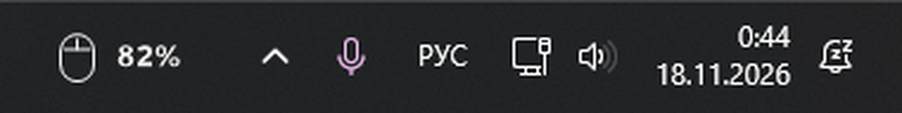
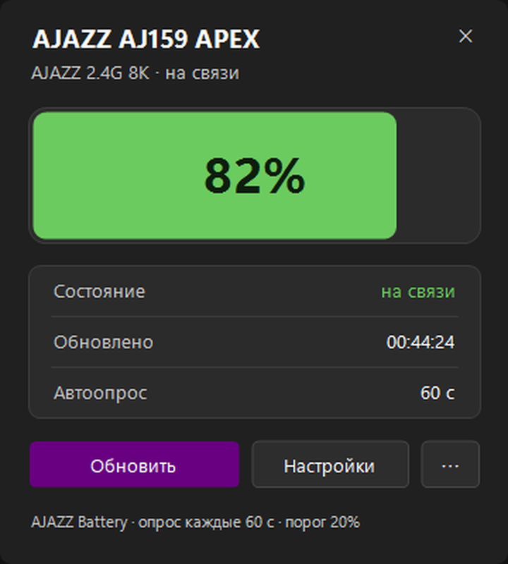
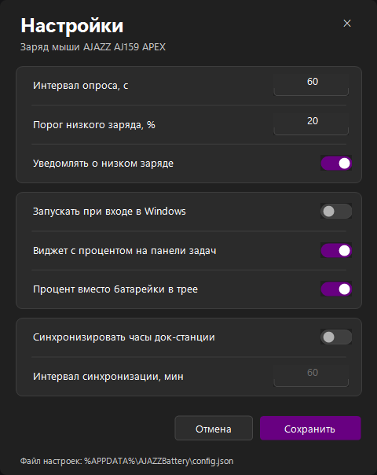
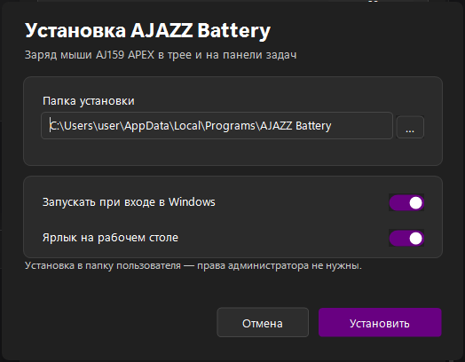

# AJAZZ Battery — заряд мыши AJ159 APEX в трее и на панели задач Windows

Приложение показывает уровень заряда беспроводной мыши **AJAZZ AJ159 APEX** прямо в Windows:
аккуратным виджетом «мышка + 82 %» на панели задач, процентом в трее и панелью в стиле Windows 11.
Официальный драйвер AJAZZ для этого не нужен — программа общается с приёмником/док-станцией
напрямую по HID.





## Возможности

- **Виджет на панели задач** «мышка + процент» — всегда на виду, не занимает место в области
  уведомлений и не создаёт кнопку приложения. Клик по виджету открывает панель. В полноэкранных
  приложениях и при скрытой панели задач виджет автоматически прячется.
- **Процент в системном трее** — крупными цифрами или значком батарейки (на выбор), с цветовой
  индикацией: зелёный ≥ 50 %, жёлтый 20–49 %, красный < 20 %.
- **Панель** с большим индикатором, состоянием связи и временем последнего опроса; закрывается
  по клику мимо, перетаскивается за заголовок.
- **Индикация зарядки**: когда заряд растёт, в панели появляется молния и надпись «заряжается»
  (см. [ограничения](#ограничения) — донгл не отдаёт отдельный флаг).
- **Уведомление о низком заряде** с настраиваемым порогом.
- **Автоопрос** раз в 60 с (настраивается), автопереподключение при переподключении донгла.
- **Автозапуск** при входе в Windows.
- **Синхронизация часов** на экранчике док-станции (та самая «00:00» после обесточивания) и
  **очистка картинки** с экрана дока.
- Тёмная и светлая темы — автоматически по системной, с системным акцентным цветом и шрифтом
  Segoe UI Variable, как в Windows 11.
- Один экземпляр в памяти: повторный запуск просто открывает панель.



## Установка

### Вариант 1. Установщик (обычный способ)

Запустите **`AJAZZ-Battery-Setup.exe`**:



- ставится в папку пользователя `%LOCALAPPDATA%\Programs\AJAZZ Battery` — **права администратора
  не нужны**;
- создаёт ярлык в меню «Пуск» (и на рабочем столе, если галочка включена);
- добавляет запись «AJAZZ Battery» в **Параметры → Приложения** — удаление оттуда же;
- опционально прописывает автозапуск.

Тихая установка:

```powershell
AJAZZ-Battery-Setup.exe /S --dir "D:\Apps\AJAZZ Battery" --no-autostart --no-desktop --no-run
```

### Вариант 2. Портативная версия

`AJAZZ-Battery-Portable.zip` — распакуйте в любую папку и запустите `AjazzBattery.exe`.
Ничего не устанавливается, ярлыки и реестр не трогаются. Настройки хранятся в
`%APPDATA%\AJAZZBattery`.

Удаление портативной версии — просто удалить папку.

## Как пользоваться

- **Левый клик по виджету на панели задач** или по иконке в трее — открыть/закрыть панель.
- **Правый клик по иконке** — меню: обновить, настройки, синхронизация часов дока, очистка экрана
  дока, автозапуск, журнал, выход.
- Иконка может попасть в «переполнение» трея (стрелка `^`) — её можно вытащить перетаскиванием.

## Настройки

| Параметр | По умолчанию | Что делает |
|---|---|---|
| Интервал опроса, с | 60 | как часто спрашивать заряд |
| Порог низкого заряда, % | 20 | когда показывать уведомление |
| Уведомлять о низком заряде | вкл | всплывающее уведомление |
| Запускать при входе в Windows | выкл | автозапуск (`HKCU\...\Run`) |
| Виджет с процентом на панели задач | вкл | виджет «мышка + процент» на панели задач |
| Процент вместо батарейки в трее | вкл | цифры `81` вместо значка батарейки |
| Синхронизировать часы док-станции | выкл | отправка времени на экран дока |
| Интервал синхронизации, мин | 60 | как часто повторять |

Файл настроек: `%APPDATA%\AJAZZBattery\config.json`, журнал — `app.log` там же.

## Командная строка

```
AjazzBattery.exe               запустить трей-приложение
AjazzBattery.exe --check       показать заряд и сырой ответ устройства
AjazzBattery.exe --diag        диагностика: найденные HID-интерфейсы и ответы
AjazzBattery.exe --set-time    синхронизировать часы док-станции
AjazzBattery.exe --clear-screen очистить картинку с экрана дока
AjazzBattery.exe --uninstall   удалить приложение (для установленной копии)
```

`--check` удобно для проверки на другом ПК:

```
Устройство : AJAZZ 2.4G 8K
Заряд      : 81%
Сырой ответ: 00 00 00 51 01 00 01 02 ...
```

## Как это работает

Официального SDK у AJAZZ нет, протокол восстановлен реверс-инжинирингом (по открытым проектам
для AJ159/AJ179 и по трафику веб-конфигуратора qmk.top).

Приёмник выставляет вендорский HID-интерфейс (`usage page 0xFFFF`, Feature Report 64 байта,
report id 0):

```
SetFeature: 00 F7 00 00 ... 00        (запрос статуса)
GetFeature: 00 00 00 51 01 00 01 02 ...
                   ^^ байт 3 — заряд в процентах
```

Команды для экрана дока:

```
SetFeature: 00 28 00 00 00 00 00 00 D7 <год hi> <год lo> <мес> <день> <час> <мин> <сек> ...
SetFeature: 00 AC 00 00 00 00 00 00 53 ...
```

Ответ приходит за ~2–10 мс, опрос раз в минуту мыши не мешает.

## Ресурсы

- В простое приложение ничего не делает: один опрос раз в 60 секунд (настраивается), один
  HID-запрос к приёмнику длится ~5 мс.
- Виджет на панели задач перерисовывается только когда меняется процент, тема или положение
  панели задач. В остальное время — ни одного кадра.
- Процессор в простое ~0 %, память 60–120 МБ (внутри — рантайм .NET одним файлом).
- Обмен идёт с **приёмником**, а не с сенсором мыши, поэтому на курсор, опрос 8 кГц и задержки
  это не влияет.

## Ограничения

- Поддерживается приёмник/док AJ159 APEX (`3151:5007`). Для других моделей AJAZZ протокол может
  отличаться — проверьте `--diag`.
- **Отдельного флага «заряжается» донгл не отдаёт.** Проверено замерами: пока мышь на доке,
  заряд растёт (82 → 86 %), но в ответе `0xF7` меняется только признак «мышь спит». Поэтому
  зарядка определяется по росту процента: обычно в течение 1–3 минут после установки на док в
  панели появляется молния. Если процент не изменился (например, мышь уже почти заряжена),
  индикации не будет.
- Данные о заряде отдаёт сам приёмник, поэтому процент актуален и когда мышь спит.
- Требуется Windows 10/11 x64; ставить .NET не нужно — рантайм внутри exe.

## Сборка из исходников

Нужен .NET SDK 9. Всё собирается одним скриптом:

```powershell
.\build.ps1
```

Результат в `dist\`:

| Файл | Что это |
|---|---|
| `AjazzBattery.exe` | портативная версия (один файл, ~46 МБ) |
| `AJAZZ-Battery-Portable.zip` | портативная версия + README |
| `AJAZZ-Battery-Setup.exe` | установщик (~92 МБ, внутри уже собранное приложение) |

Структура:

```
src/AjazzBattery/          приложение
  Program.cs               точка входа, режимы CLI, single instance, --uninstall
  HidInterop.cs            P/Invoke: SetupAPI + hid.dll
  AjazzReader.cs           протокол: статус, время дока, очистка экрана
  TrayContext.cs           NotifyIcon, меню, опрос, зарядка, уведомления
  TaskbarAnchor.cs         невидимое окно → кнопка с процентом на панели задач
  PanelForm.cs             всплывающая панель
  SettingsForm.cs          окно настроек
  BatteryGlyph.cs          многоразмерная иконка трея
  NumberField.cs, NativeUi.cs, Theme.cs, DarkColorTable.cs — элементы UI
  Uninstaller.cs           удаление приложения
src/AjazzBattery.Setup/    установщик (встраивает приложение в exe)
docs/                      заметки по протоколу
GIT.md                     как выложить проект на GitHub
```

## Публикация на GitHub

Пошаговая инструкция (создание репозитория, токен или SSH-ключ, релизы с exe) — в
[GIT.md](GIT.md).

